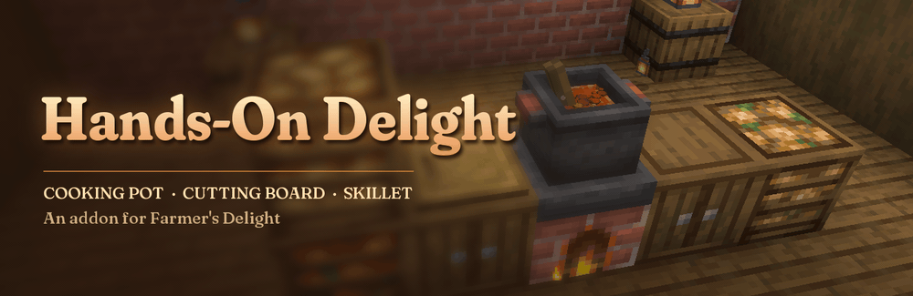
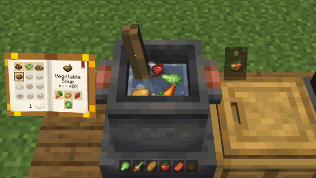
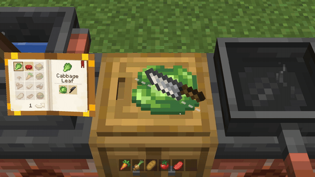
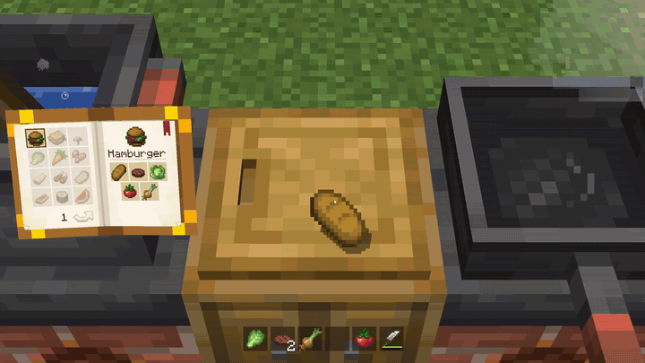
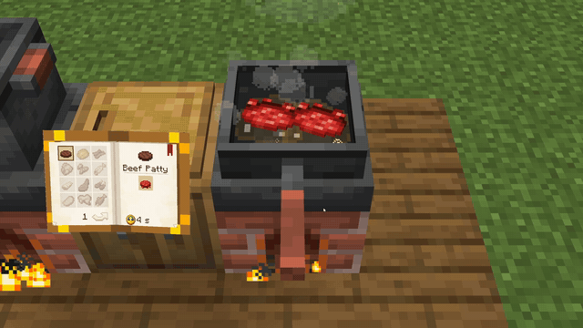

<!-- CurseForge description of Hands-On Delight. HTML: paste it in the editor's HTML (source) mode, not Markdown mode.
     The "more-mods" block is generated by tools/mod-catalog/sync_mod_links.py - never edit it by hand. -->

   

<em>Cook in <a href="https://www.curseforge.com/minecraft/mc-mods/farmers-delight">Farmer's Delight</a> with your own hands.</em>

<strong>The cooking pot, the cutting board and the skillet open right where they stand, with no menu screen. You stir the soup with the spoon and chop with the knife yourself, and players nearby see what you cook.</strong>

<strong>No menus</strong>, the blocks open in the world &nbsp;&middot;&nbsp; <strong>Every recipe</strong> of Farmer's Delight and its addons &nbsp;&middot;&nbsp; <strong>No new blocks or items</strong>

<h2 style="text-align:center">The cutting board</h2>

<em>Lay the food on the board and cut along the marks with the knife in hand. One cut goes through sixteen at once, and the pieces fly into your inventory.</em>

<h2 style="text-align:center">Burgers on the board</h2>

<em>Bread first, then whatever goes on it: the last layer turns the stack into the dish. Sandwiches no longer take the crafting table, and those of addons are built the same way.</em>

<h2 style="text-align:center">The skillet</h2>

<em>Food fries on the side that lies in the pan. Toss the pan by its handle and it turns over in the air.</em>

<h2 style="text-align:center">Stars and the recipe book</h2>

<em>Stir in wide, steady rounds and stars fill over the dish, each one adding servings. A recipe book beside every station shows what you can make right now. Put the stations side by side and the camera walks along them.</em>

<h3 style="text-align:center">Getting started</h3>

Put the mod and <a href="https://www.curseforge.com/minecraft/mc-mods/diegesis">Diegesis</a> into the mods folder of the client and the server, then right-click a station. On <a href="https://fabricmc.net">Fabric</a> it needs <a href="https://www.curseforge.com/minecraft/mc-mods/farmers-delight-refabricated">Farmer's Delight Refabricated</a> and <a href="https://www.curseforge.com/minecraft/mc-mods/fabric-api">Fabric API</a>. A client without the mod keeps Farmer's Delight's own menus. Hoppers and autocrafters keep working, and <code>config/handson_delight.properties</code> turns off any station or the stirring the pot waits for.

<strong>Works with</strong>

    

<!-- more-mods:start icons -->

<b>More mods by Pocky</b>

<!-- more-mods:end -->

Made by <strong>Pocky</strong>. Built on <a href="https://www.curseforge.com/minecraft/mc-mods/diegesis">Diegesis</a>; the models and sounds of the stations come from the installed <a href="https://www.curseforge.com/minecraft/mc-mods/farmers-delight">Farmer's Delight</a>. The broth sound is a CC0 recording by Joseph Sardin from <a href="https://bigsoundbank.com">BigSoundBank</a>. Source on <a href="https://github.com/Pocky-l/handson-delight">GitHub</a> (MIT).

