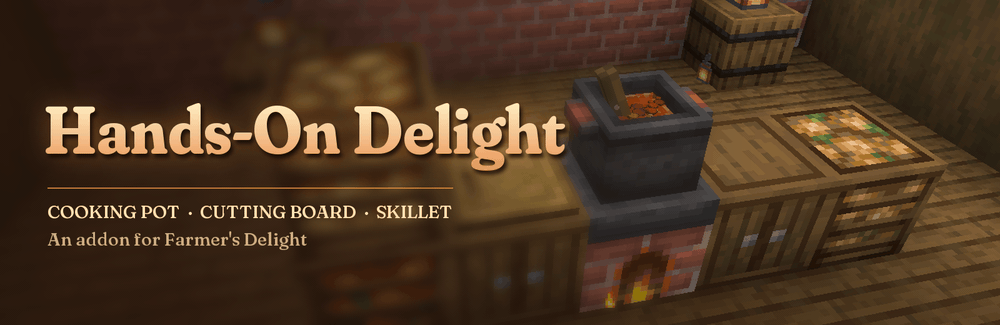
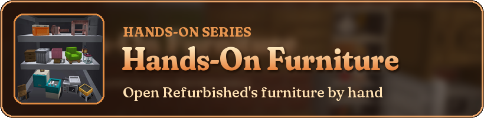
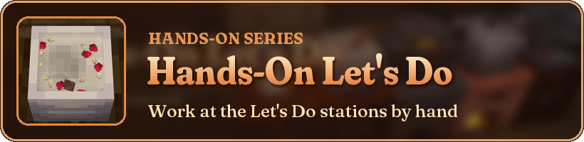
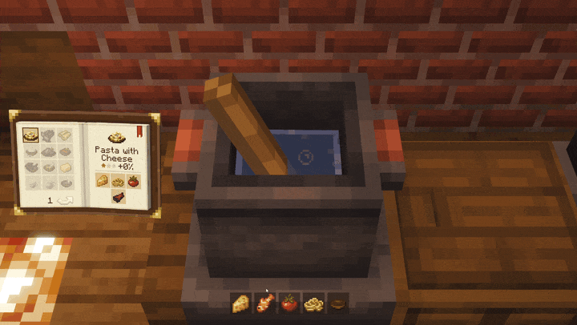
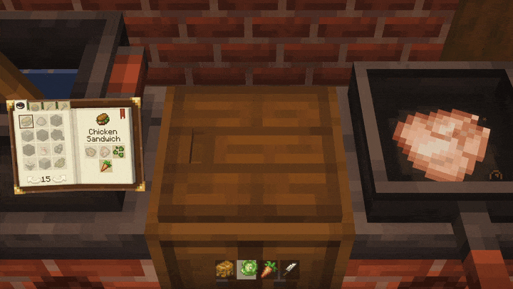
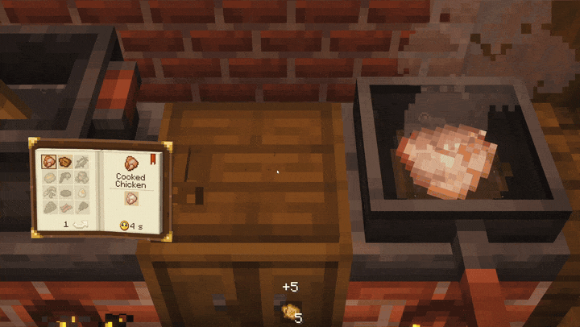
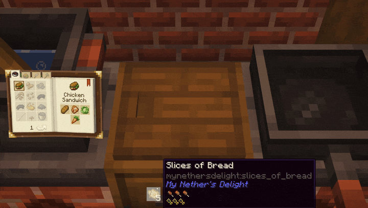
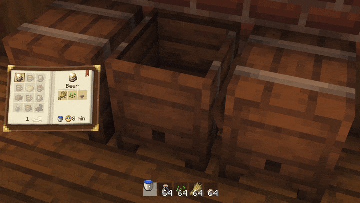
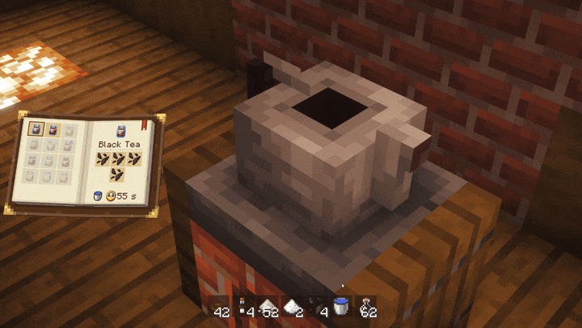
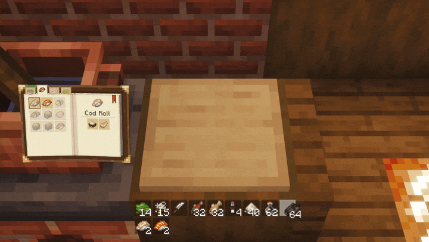

<!-- CurseForge description of Hands-On Delight. HTML: paste it in the editor's HTML (source) mode, not Markdown mode.
     The "more-mods" block is generated by tools/mod-catalog/sync_mod_links.py - never edit it by hand. -->

<!-- more-mods:start family -->

 &nbsp; &nbsp;

<!-- more-mods:end -->

    

<em>Cook in <a href="https://www.curseforge.com/minecraft/mc-mods/farmers-delight">Farmer's Delight</a> with your own hands.</em>

<strong>The cooking pot, the cutting board, the skillet and the stations of the addons open right where they stand, with no menu screen. You stir the soup with the spoon and chop with the knife yourself, and players nearby see what you cook.</strong>

<strong>No menus</strong>, the blocks open in the world &nbsp;&middot;&nbsp; <strong>Every recipe</strong> of Farmer's Delight and its addons &nbsp;&middot;&nbsp; <strong>No new blocks or items</strong>

<h2 style="text-align:center">The cutting board</h2>

<em>Lay the food on the board and cut along the marks with the knife in hand. One cut goes through sixteen at once, and the pieces fly into your inventory.</em>

<h2 style="text-align:center">The skillet</h2>

<em>Food fries on the side that lies in the pan. Toss the pan by its handle and it turns over in the air.</em>

<h2 style="text-align:center">Sandwiches on the board</h2>

<em>Bread first, then whatever goes on it: the last layer turns the stack into the dish. Sandwiches no longer take the crafting table, and those of addons are built the same way.</em>

<h2 style="text-align:center">The keg</h2>

<em><a href="https://modrinth.com/mod/brewin-and-chewin">Brewin' and Chewin'</a>'s keg opens under its lid. Pour the water in and drop in what ferments. When the drink is ready, the tap fills one mug at a time.</em>

<h2 style="text-align:center">The kettle</h2>

<em>Lift the lid of a kettle from <a href="https://modrinth.com/mod/gensokyo-delight-youkais-feasts">Gensokyo Delight: Youkai's Feasts</a> or <a href="https://modrinth.com/mod/farmers-respite">Farmer's Respite</a>, pour the water and drop the leaves in. When the tea is brewed, tip the kettle by its handle and fill the cups.</em>

<h2 style="text-align:center">Sushi on the cuisine board</h2>

<em><a href="https://modrinth.com/mod/gensokyo-delight-youkais-feasts">Youkai's Feasts</a>' cuisine board builds rolls step by step, and the book beside it shows each step. Roll the sheet up from your side and cut the roll with the knife.</em>

<h2 style="text-align:center">Stars and the recipe book</h2>

<em>Stir in wide, steady rounds and stars fill over the dish, each one adding servings. A recipe book beside every station shows what you can make right now. Put the stations side by side and the camera walks along them.</em>

<!-- stations:start -->
<h2 style="text-align:center">Station compatibility</h2>

<em>How much of each mod's kitchen opens as stations right in the world. A dash means the mod has no build for that version.</em>

<strong>Every mod with stations and the planned ones</strong>

<table style="margin-left:auto;margin-right:auto" cellpadding="4">
<tbody>
<tr><th>Mod</th><th>Stations</th><th>1.20.1</th><th>1.21.1</th></tr>
<tr><td> <a href="https://www.curseforge.com/minecraft/mc-mods/farmers-delight">Farmer's Delight</a></td><td> 100%</td><td align="center">✅</td><td align="center">✅</td></tr>
<tr><td> <a href="https://modrinth.com/mod/barbeques-delight-forge">Barbeque's Delight</a></td><td> 100%</td><td align="center">✅</td><td align="center">✅</td></tr>
<tr><td> <a href="https://modrinth.com/mod/brewin-and-chewin">Brewin' and Chewin'</a></td><td> 100%</td><td align="center">✅</td><td align="center">✅</td></tr>
<tr><td> <a href="https://modrinth.com/mod/choppers-delight">Chopper's Delight</a></td><td> 100%</td><td align="center">✅</td><td align="center">✅</td></tr>
<tr><td> <a href="https://modrinth.com/mod/cooking-for-blockheads">Cooking for Blockheads</a></td><td> 100%</td><td align="center">✅</td><td align="center">✅</td></tr>
<tr><td> <a href="https://modrinth.com/mod/cultural-delights">Cultural Delights</a></td><td> 100%</td><td align="center">-</td><td align="center">✅</td></tr>
<tr><td> <a href="https://modrinth.com/mod/dungeons_delight">Dungeons Delight</a></td><td> 100%</td><td align="center">✅</td><td align="center">✅</td></tr>
<tr><td> <a href="https://www.curseforge.com/minecraft/mc-mods/ends-delight">End's Delight</a></td><td> 100%</td><td align="center">✅</td><td align="center">✅</td></tr>
<tr><td> <a href="https://modrinth.com/mod/extradelight">Extra Delight</a></td><td> 83%</td><td align="center">-</td><td align="center">✅</td></tr>
<tr><td> <a href="https://modrinth.com/mod/farmers-respite">Farmer's Respite</a></td><td> 100%</td><td align="center">✅</td><td align="center">✅</td></tr>
<tr><td> <a href="https://modrinth.com/mod/farmers-spell">Farmer's Spell 'n Spell Book</a></td><td> 100%</td><td align="center">✅</td><td align="center">✅</td></tr>
<tr><td> <a href="https://modrinth.com/mod/gensokyo-delight-youkais-feasts">Gensokyo Delight: Youkai's Feasts</a></td><td> 100%</td><td align="center">✅</td><td align="center">✅</td></tr>
<tr><td> <a href="https://modrinth.com/mod/hearth-and-harvest">Hearth and Harvest</a></td><td> 100%</td><td align="center">✅</td><td align="center">✅</td></tr>
<tr><td> <a href="https://modrinth.com/mod/miners-delight">Miner's Delight</a></td><td> 100%</td><td align="center">✅</td><td align="center">✅</td></tr>
<tr><td> <a href="https://www.curseforge.com/minecraft/mc-mods/my-nethers-delight">My Nether's Delight</a></td><td> 100%</td><td align="center">✅</td><td align="center">✅</td></tr>
<tr><td> <a href="https://modrinth.com/mod/nethers-delight">Nether's Delight</a></td><td> 100%</td><td align="center">✅</td><td align="center">-</td></tr>
<tr><td> <a href="https://www.curseforge.com/minecraft/mc-mods/sable-trees">Sable Trees</a></td><td> 100%</td><td align="center">-</td><td align="center">✅</td></tr>
<tr><td> <a href="https://modrinth.com/mod/trailtales-delight">Trail&amp;Tales Delight</a></td><td> 50%</td><td align="center">✅</td><td align="center">✅</td></tr>
<tr><td> <a href="https://modrinth.com/mod/twilight-delight">Twilight's Flavor &amp; Delight</a></td><td> 100%</td><td align="center">✅</td><td align="center">✅</td></tr>
<tr><td> <a href="https://modrinth.com/mod/vintage-delight">Vintage Delight</a></td><td> 100%</td><td align="center">✅</td><td align="center">-</td></tr>
<tr><td> <a href="https://modrinth.com/mod/youkaishomecoming">Youkai's Homecoming</a></td><td> 83%</td><td align="center">✅</td><td align="center">-</td></tr>
<tr><th>Planned</th><th></th><th></th><th></th></tr>
<tr><td> <a href="https://modrinth.com/mod/berries-and-cherries">Berries and Cherries Delight</a></td><td></td><td></td><td></td></tr>
<tr><td> <a href="https://modrinth.com/mod/cuisine-delight">Cuisine Delight</a></td><td></td><td></td><td></td></tr>
<tr><td> <a href="https://modrinth.com/mod/delightful">Delightful</a></td><td></td><td></td><td></td></tr>
<tr><td> <a href="https://modrinth.com/mod/enders-delight">Ender's Delight</a></td><td></td><td></td><td></td></tr>
<tr><td> <a href="https://modrinth.com/mod/farmers-pizzeria">Farmer's Pizzeria</a></td><td></td><td></td><td></td></tr>
<tr><td> <a href="https://modrinth.com/mod/immortalers-delight">Immortalers Delight</a></td><td></td><td></td><td></td></tr>
<tr><td> <a href="https://www.curseforge.com/minecraft/mc-mods/legendary-delicacies">Legendary Delicacies</a></td><td></td><td></td><td></td></tr>
<tr><td> <a href="https://www.curseforge.com/minecraft/mc-mods/survivors-delight">Survivor's Delight</a></td><td></td><td></td><td></td></tr>
<tr><td> <a href="https://modrinth.com/mod/ubes-delight">Ube's Delight</a></td><td></td><td></td><td></td></tr>
</tbody>
</table>

<!-- stations:end -->

 ✅ <a href="https://modrinth.com/mod/culinary-compat">Culinary Compat</a> (Forge 1.20.1): its cuts of several things at once work on the board.

<h3 style="text-align:center">Getting started</h3>

Put the mod and <a href="https://www.curseforge.com/minecraft/mc-mods/diegesis">Diegesis</a> into the mods folder of the client and the server, then right-click a station. On <a href="https://fabricmc.net">Fabric</a> it needs <a href="https://www.curseforge.com/minecraft/mc-mods/farmers-delight-refabricated">Farmer's Delight Refabricated</a> and <a href="https://www.curseforge.com/minecraft/mc-mods/fabric-api">Fabric API</a>. A client without the mod keeps Farmer's Delight's own menus. Hoppers and autocrafters keep working, and <code>config/handson_delight.properties</code> turns off any station or the stirring the pot waits for. Modpacks put any craft together on the cutting board with the item tag <code>handson_delight:assembled</code>: see <a href="https://github.com/Pocky-l/handson-delight#modpacks">Modpacks</a> in the README.

 Bug reports, questions and ideas for new stations are welcome in <a href="https://discord.gg/mGkPKccJEf">Pocky's Kitchen</a>, our Discord server.

Made by <strong>Pocky</strong>. Built on <a href="https://www.curseforge.com/minecraft/mc-mods/diegesis">Diegesis</a>; the models and sounds of the stations come from the installed <a href="https://www.curseforge.com/minecraft/mc-mods/farmers-delight">Farmer's Delight</a>. The broth sound is a CC0 recording by Joseph Sardin from <a href="https://bigsoundbank.com">BigSoundBank</a>. Source on <a href="https://github.com/Pocky-l/handson-delight">GitHub</a> (MIT).

