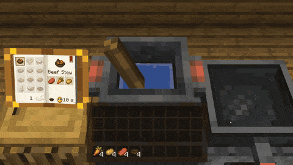

# Hands-On Delight

An experimental addon for [Farmer's Delight](https://www.curseforge.com/minecraft/mc-mods/farmers-delight), built on
[Diegesis](https://github.com/Pocky-l/diegesis). It turns the menus of Farmer's Delight into things you use right in the
world.

For now it is the cooking pot. Open it and you see water inside, and the food you put in floats and colours it. Stir
with the spoon until the soup is done, then click it with a bowl. Players nearby see the soup simmer. Recipes, hoppers
and drops work as in Farmer's Delight.

Minecraft 1.20.1, Forge. MIT License, author Pocky.
