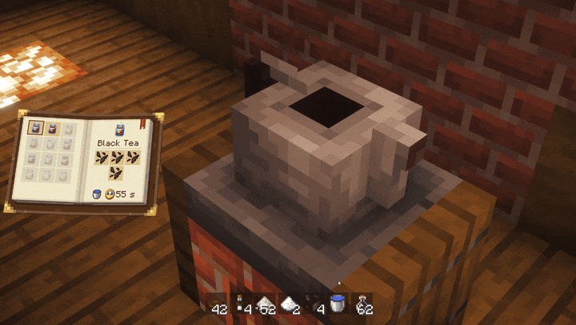
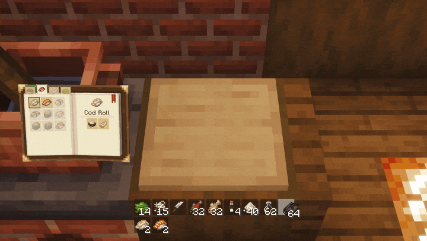
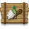

<h1 align="center">Hands-On Delight</h1>

<p align="center">
  Cook in <a href="https://www.curseforge.com/minecraft/mc-mods/farmers-delight">Farmer's Delight</a> with your own hands:
  the cooking pot, the cutting board, the skillet and the stove open right in the world.
</p>

<p align="center">
  <a href="https://www.curseforge.com/minecraft/mc-mods/hands-on-delight"></a>
  
  <a href="https://neoforged.net"></a>
  <a href="https://fabricmc.net"></a>
  
</p>

<p align="center"><b>The cooking pot, the cutting board, the skillet, the stove and the stations of the addons open right where they stand, with no menu screen. You stir the soup with the spoon and chop with the knife yourself, and players nearby see what you cook.</b></p>

<p align="center"></p>

<p align="center"><b>No menus</b>, the blocks open in the world &middot; <b>Every recipe</b> of Farmer's Delight and its addons &middot; <b>No new blocks or items</b></p>

Built on [Diegesis](https://www.curseforge.com/minecraft/mc-mods/diegesis).

## Features

<h3 align="center">The cutting board</h3>
<p align="center"></p>
<p align="center"><i>Lay the food on the board and cut along the marks with the knife in hand.<br>One cut goes through sixteen at once, and the pieces fly into your inventory.</i></p>

<h3 align="center">The skillet</h3>
<p align="center"></p>
<p align="center"><i>Food fries on the side that lies in the pan. Toss the pan by its handle and it turns over in the air.</i></p>

<h3 align="center">Sandwiches on the board</h3>
<p align="center"></p>
<p align="center"><i>Bread first, then whatever goes on it: the last layer turns the stack into the dish.<br>Sandwiches no longer take the crafting table, and those of addons are built the same way.</i></p>

<h3 align="center">The keg</h3>
<p align="center"></p>
<p align="center"><i><a href="https://modrinth.com/mod/brewin-and-chewin">Brewin' and Chewin'</a>'s keg opens under its lid. Pour the water in and drop in what ferments.<br>When the drink is ready, the tap fills one mug at a time.</i></p>

<h3 align="center">The kettle</h3>
<p align="center"></p>
<p align="center"><i>Lift the lid of a kettle from <a href="https://modrinth.com/mod/gensokyo-delight-youkais-feasts">Gensokyo Delight: Youkai's Feasts</a> or <a href="https://modrinth.com/mod/farmers-respite">Farmer's Respite</a>, pour the water and drop the leaves in.<br>When the tea is brewed, tip the kettle by its handle and fill the cups.</i></p>

<h3 align="center">Sushi on the cuisine board</h3>
<p align="center"></p>
<p align="center"><i><a href="https://modrinth.com/mod/gensokyo-delight-youkais-feasts">Youkai's Feasts</a>' cuisine board builds rolls step by step, and the book beside it shows each step.<br>Roll the sheet up from your side and cut the roll with the knife.</i></p>

### In detail

- **Cooking pot.** Food floats in the water and colours it. Take the spoon by its handle and stir: the whole pot cooks
  as one batch, sixteen servings in about 27 seconds. Walk away and it cooks on as Farmer's Delight cooks, a serving at
  a time.
- **Stars.** Wide, steady rounds fill up to three stars over the dish. Two stars add a serving for every four, three
  stars one for every two. A dish opens its second star after 8 servings and its third after 32.
- **Recipe book.** It hangs beside the station and puts what you can make now first. Click a dish and its ingredients
  go into the pot from your inventory; Shift + click puts in up to sixteen sets.
- **Cutting board.** Right-click it with food to lay the food down. The knife stays in your hand or inventory and shows
  over the food: chop on the dashed marks; each cut goes through sixteen items of the stack. Food is cut across its own
  length, a kelp roll in even slices and a pie in wedges, with one cut for each piece it gives, three at most. Everything
  else Farmer's Delight cuts on its board is worked there too, each with its own tool and stroke: an axe strips a log down
  its side and splits a door, a pickaxe cracks stone and bricks, a shovel digs into clay and gravel, a hoe pries the chest
  off a boat or a cart, shears snip leather armour and saddles.
- **Dishes on the board.** Farmer's Delight's food crafts move from the crafting table to the cutting board: lay what
  goes down first (bread, a bowl, a stick, kelp, wheat, a pie crust), put the rest on it, and the dish is made. Salads
  are tossed in their bowl and plated meals laid in it, sandwiches closed with their bread, skewers threaded from the
  tip, dough kneaded. Milk and honey are poured, eggs cracked. Machines such as Create's and
  AE2's autocrafters still craft them, and so do players without this mod on a server that has it.
- **Board recipe book.** Tabs show everything, the dishes only or the cuts only. Click a dish and it is laid from your
  inventory; Shift + click lays sixteen.
- **Skillet.** Food fries on the side that lies on the pan, then smokes and waits. Toss the pan by its handle to turn it.
  When both sides are done, click the food to take it. Up to sixteen fry together. Eggs go in cracked and fry
  sunny side up, with no toss.
- **Stove.** Up to six pieces grill on its top. Each one smokes when its lower side is done: click it to turn it over.
  Once both sides are done it waits on the grill until you take it. Eggs would run through the grill: fry them in a
  skillet.
- **Keg** of [Brewin' and Chewin'](https://modrinth.com/mod/brewin-and-chewin). Its lid opens on the
  liquid: pour a bucket or a bottle in at the opening, drop the ingredients in and they float while it ferments, the
  colour turning to the drink's. A thermometer on its badge shows how warm the keg is and how warm the recipe wants it.
  Click the tap with a tankard or a bottle to draw a drink and watch it run in and rise under its head of foam; with an
  empty hand one is offered from your inventory, and Shift draws as many as there are.
- **Oven** of [Cultural Delights](https://modrinth.com/mod/cultural-delights). A brick oven with a hearth inside and a
  grated door. Its door opens like a pair of gates and the baking tray slides out: lay what you bake on it, a pie's
  filling on its crust. Shut the door and it bakes over the stove or fire under it. Through the grate you see it brown
  and the fire glow, and the badge counts down the seconds. Its book has every baking recipe, Farmer's Delight's pies
  and cakes among them.
- **Vat** of [Cultural Delights](https://modrinth.com/mod/cultural-delights). A stone tub under a lid that swings up.
  Pour water or milk in and drop the rest in to float, shut the lid and it ages at the warmth under it: it boils over a
  fire and frosts over on ice. The drink stays in the vat until you draw it with a bottle, beer under its head of foam.
- **Vat** of [Extra Delight](https://modrinth.com/mod/extradelight). Its crock opens up: pour the brine in, drop the
  vegetables in to float and shake in the salt or yeast each stage wants. Its lid comes off and goes back on as each
  stage needs it, from your inventory when you leave. The badge shows the stages, what the one under way still wants and
  the days left, and the book lists every recipe with its stages. What it makes waits in the vat, no jars or bowls needed
  until you draw it into them.
- **Melting pot** of [Extra Delight](https://modrinth.com/mod/extradelight). A double boiler, its upper pot open over the
  heat: drop chocolate in and watch it soften, sink and melt into the syrup going round in it, while the water below
  steams. Its book has everything it melts, with the time. Click the syrup with a bottle or a bucket to fill it; with an
  empty hand a bottle is offered from your inventory.
- **Kettle** of [Farmer's Respite](https://modrinth.com/mod/farmers-respite-unofficial-port). Lift its lid off onto the stove, pour
  a bucket in at the opening and drop the leaves in: they float, soak and sink, giving the water their colour while it
  brews over the fire, with steam rising from the spout. Done, the kettle whistles. Click the spout with a bottle and
  the kettle is lifted by its handle and tipped to pour one; with an empty hand a bottle is offered from your
  inventory, and Shift pours every cup there is.
- **Kettle** of [Gensokyo Delight: Youkai's Feasts](https://modrinth.com/mod/gensokyo-delight-youkais-feasts). The same station: its water comes to the boil first, warming and
  steaming until the kettle whistles, then its four leaves steep into tea.
- **Cuisine board** of [Gensokyo Delight: Youkai's Feasts](https://modrinth.com/mod/gensokyo-delight-youkais-feasts). Sushi
  and rolls step by step, in the order its book shows: what you put on comes down onto the board, sauce is poured, an
  empty hand shapes the nigiri or rolls the sheet up, and a knife cuts the roll along dashed lines, as on the board.
- **Pots** of [Gensokyo Delight: Youkai's Feasts](https://modrinth.com/mod/gensokyo-delight-youkais-feasts): the small
  iron pot, the short iron pot and the stockpot. Food comes down into the soup, sauce and cream are poured, you stir
  the stockpot with its ladle, and the book has every dish of that pot with its time.
- **Steamer** of [Gensokyo Delight: Youkai's Feasts](https://modrinth.com/mod/gensokyo-delight-youkais-feasts), however
  tall. The lid comes off, food goes onto the place you let it go over, and a click on any rack opens it, with the racks
  over it lifted aside. The badge counts down what steams, and the book lays its recipes from your inventory.
- **Fermentation tank** of [Gensokyo Delight: Youkai's Feasts](https://modrinth.com/mod/gensokyo-delight-youkais-feasts).
  Its lid comes off with a click, liquids are poured in and things dropped in, and it ferments under the lid with the
  badge counting down. The drink is dipped out with a bottle, and the book puts its recipes in from your inventory.
- **Chopping block** of [Sable Trees](https://www.curseforge.com/minecraft/mc-mods/sable-trees), the stump a felled tree
  leaves. Food laid on it is cut along its marks as on the board. A log stands on it one at a time and is split like a
  pie: the axe comes down from high above on each of three dashed lines through its middle, the cuts open, and with the
  third the wedges fall apart and the planks come to you, half as many again as the crafting table gives. Its dirt
  grows with the food cut on it, and after 32 cuts it takes no more food.
- **Grill** of [Barbeque's Delight](https://modrinth.com/mod/barbeques-delight-forge). Two skewers lie over its fire.
  One smokes when its lower side is done: click it to turn it over, once. Click a skewer with a powder to shake it over
  or with a sauce to dab it on, and the seasoning stays on it. A skewer left on after it is done darkens, smokes and
  burns, as in Barbeque's Delight.
- **Ingredients basin** of [Barbeque's Delight](https://modrinth.com/mod/barbeques-delight-forge). Put the meat in one
  compartment and the side in the other. A stick from your inventory lies ready on its rim: click it and the pieces go
  onto it one after another, the side from the other compartment, nothing in your off hand. Shift makes as many as
  there is food for.
- **Alchemist pot** of [Farmer's Spell 'n Spell Book](https://modrinth.com/mod/farmers-spell). Stir it with its stick
  like the cooking pot. An [Iron's Spells 'n Spellbooks](https://modrinth.com/mod/irons-spells-n-spellbooks) scroll
  clicked on it hangs over its rim and its school shows on the pot: a fire scroll burns under it and heats it. Dishes
  that need a school wait for their scroll, which blinks on the badge and stands with them in the book.
- **Mixing bowl** of [Extra Delight](https://modrinth.com/mod/extradelight). Drop the food in, pour liquids from their
  bottles and buckets, crack eggs over the rim (a right click cracks one for its white and gives you the yolk). Your
  spoon or whisk stands in the bowl: click its handle and stir, each circle round the bowl is a stir, and everything in
  it goes round and turns into the mixture. A whole bowlful is mixed at once. Done, a bowl or bottle from your inventory
  dips in for it. Its book pours the liquids too.
- **A kitchen.** Rest the cursor at the edge of the screen beside another station and the camera moves over to it. A, D
  and the arrow keys do the same.
- **For everyone.** Players nearby see the soup simmer, the spoon go round and the food land on the board.

## Controls

| Action | How |
|---|---|
| Open a station | Right-click the pot, board, skillet, stove, keg, oven, vat, grill, basin, kettle or mixing bowl |
| Open a station | Right-click the pot, board, skillet, stove, keg, oven, vat, melting pot, grill, basin or kettle |
| Use the block as in Farmer's Delight | Sneak + right-click |
| Stir | Click the spoon's handle, move the mouse, click again to put it down |
| Serve | Click the soup with a bowl |
| Put a whole stack in | Shift + click it in the inventory |
| Cut | Left-click what lies on the board: the knife, or the tool the cut takes, comes from your inventory |
| Turn a piece on the stove | Click it |
| Take food back | Right-click it |
| Put the knife away | Right-click with it |
| Stick a tool into the board | Shift + click the bare board with it; click it to take it out |
| Go to the next station | Rest the cursor at the screen's edge on its side, or press A, D or an arrow key |

## Compatibility

[](https://www.curseforge.com/minecraft/mc-mods/jei) ✅ **[JEI](https://www.curseforge.com/minecraft/mc-mods/jei)** (optional) - shows the board's dishes

[](https://www.curseforge.com/minecraft/mc-mods/emi) ✅ **[EMI](https://www.curseforge.com/minecraft/mc-mods/emi)** (optional) - the same

[](https://www.curseforge.com/minecraft/mc-mods/roughly-enough-items) ✅ **[REI](https://www.curseforge.com/minecraft/mc-mods/roughly-enough-items)** (optional) - the same

[](https://modrinth.com/mod/sodium) ✅ **[Sodium](https://modrinth.com/mod/sodium)** and [](https://modrinth.com/mod/iris) **[Iris](https://modrinth.com/mod/iris)** (optional) - the stations draw as usual

[](https://modrinth.com/mod/extradelight) ✅ **[Extra Delight](https://modrinth.com/mod/extradelight)** (optional) - its melting pot is a station

[](https://modrinth.com/mod/create-aeronautics) ✅ **[Create Aeronautics](https://modrinth.com/mod/create-aeronautics)** (optional) - the stations open on its flying ships and stay with the ship as it flies and turns

Addons of Farmer's Delight work too: their dishes are made on the board, their pies and cakes are cut in wedges, and
the stoves of [End's Delight](https://www.curseforge.com/minecraft/mc-mods/ends-delight) and
[My Nether's Delight](https://www.curseforge.com/minecraft/mc-mods/my-nethers-delight) open as stations. So do
[Miner's Delight](https://modrinth.com/mod/miners-delight)'s copper pot,
[Dungeons Delight](https://modrinth.com/mod/dungeons_delight)'s monster pot and dungeon stove, and every cutting board of
[Chopper's Delight](https://modrinth.com/mod/choppers-delight), the decorated one too, each in its own look.
[Farmer's Respite](https://modrinth.com/mod/farmers-respite-unofficial-port)'s kettle opens as a station too, its tray on a stove
drawn with Farmer's Delight's own, and so does [Gensokyo Delight: Youkai's Feasts](https://modrinth.com/mod/gensokyo-delight-youkais-feasts)'s kettle,
its cuisine board and its three pots. [Extra Delight](https://modrinth.com/mod/extradelight)'s mixing bowl opens as a
station with its own recipes, spoons and whisk.
[Farmer's Spell 'n Spell Book](https://modrinth.com/mod/farmers-spell)'s alchemist pot opens as a pot station with
its [Iron's Spells 'n Spellbooks](https://modrinth.com/mod/irons-spells-n-spellbooks) scroll.
[Barbeque's Delight](https://modrinth.com/mod/barbeques-delight-forge)'s kebabs and bibimbap are put together on the
board and keep the seasoning of their skewers. [Extra Delight](https://modrinth.com/mod/extradelight)'s vat opens as a
station too, in each of its looks.
[Sable Trees](https://www.curseforge.com/minecraft/mc-mods/sable-trees)' chopping block opens as a station of its own,
for cutting food and splitting logs.

Hoppers, pipes and drops use the blocks' own inventories. A pot fed by automation cooks by itself, as in Farmer's Delight.

## Configuration

`config/handson_delight.properties`, read at startup. On a server it decides for every player, except `recipe_book`,
which each player sets in their own file.

| Key | Default | What it does |
|---|---|---|
| `cooking_pot`, `cutting_board`, `skillet`, `stove` | `true` | The station of that block. Off, the block works as in Farmer's Delight. `cooking_pot` covers the addons' pots too (copper, monster, alchemist) |
| `keg` | `true` | Brewin' and Chewin's keg as a station. Off, the keg keeps its own menu |
| `oven`, `vat` | `true` | Cultural Delights' oven and vat as stations. Off, they keep their own menus |
| `ed_vat` | `true` | Extra Delight's vat as a station. Off, it keeps its own menu. It keeps its own aging times; on, it also ages with no jars or bowls in it and keeps what it made to be drawn into them |
| `melting_pot` | `true` | Extra Delight's melting pot as a station. Off, it keeps its own menu. It keeps its own melting times |
| `kettle` | `true` | The kettles of Farmer's Respite and Youkai's Feasts as stations. Off, each is used as before |
| `grill`, `basin` | `true` | Barbeque's Delight's grill and ingredients basin as stations. Off, they are used as before |
| `cuisine_board` | `true` | Youkai's Feasts' cuisine board as a station. Off, it is used as before |
| `chopping_block` | `true` | Sable Trees' chopping block (a tree's stump) as a station. Off, it is used as before |
| `youkai_pots` | `true` | Youkai's Feasts' small iron pot, short iron pot and stockpot as stations. Off, they are used as before. They keep their own cooking times |
| `youkai_steamer` | `true` | Youkai's Feasts' steamer as a station. Off, it is used as before. It keeps its own steaming times |
| `youkai_tank` | `true` | Youkai's Feasts' fermentation tank as a station. Off, it is used as before. It keeps its own fermenting times |
| `mixing_bowl` | `true` | Extra Delight's mixing bowl as a station. Off, it keeps its own menu |
| `youkai_hints` | `false` | Youkai's Feasts' squares on the right of the screen while one of its blocks is looked at (what it takes next, what lies in it). Hidden unless on |
| `remove_crafting_recipes` | `true` | Farmer's Delight's food crafts are made on the board only |
| `stirring_required` | `true` | Food you put into the pot waits for the spoon while you are at it |
| `recipe_book` | `true` | The recipe book beside the stations |
| `cooking_pot_time`, `skillet_time`, `stove_time` | `1.0` | How long food takes at that station: `2.0` twice as long, `0.5` half, from `0.1` to `10`. The pot's covers food left alone and fed by hoppers too, and the addons' pots |
| `kettle_time` | `1.0` | The same for drinks brewed in Farmer's Respite's kettle, at the station, in its menu or fed by a hopper. Youkai's Feasts' kettle keeps its own times |

## Modpacks

Recipes from datapacks and [KubeJS](https://www.curseforge.com/minecraft/mc-mods/kubejs) scripts work at every
station, whatever mod or datapack adds them: the pot cooks every `farmersdelight:cooking` recipe, the board cuts every
`farmersdelight:cutting` recipe, the skillet and the stove cook every campfire recipe. A soup, in
`data/mypack/recipe/carrot_soup.json`:

```json
{
  "type": "farmersdelight:cooking",
  "ingredients": [
    { "tag": "c:crops/carrot" },
    { "item": "minecraft:brown_mushroom" }
  ],
  "result": { "id": "mypack:carrot_soup" },
  "container": { "id": "minecraft:bowl" },
  "cookingtime": 200,
  "experience": 1.0,
  "recipe_book_tab": "meals"
}
```

Dishes put together on the board are crafting recipes. The board takes those of Farmer's Delight and its addons by
itself; for any other shaped or shapeless craft, add its result to the item tag `handson_delight:assembled`. A sandwich,
in `data/mypack/recipe/club_sandwich.json`:

```json
{
  "type": "minecraft:crafting_shapeless",
  "ingredients": [
    { "item": "minecraft:bread" },
    { "item": "farmersdelight:cooked_bacon" },
    { "item": "farmersdelight:tomato" }
  ],
  "result": { "id": "mypack:club_sandwich" }
}
```

and in `data/handson_delight/tags/item/assembled.json`:

```json
{ "replace": false, "values": ["mypack:club_sandwich"] }
```

The same with KubeJS:

```js
ServerEvents.recipes(event => {
  event.shapeless('mypack:club_sandwich', ['minecraft:bread', 'farmersdelight:cooked_bacon', 'farmersdelight:tomato'])
})
ServerEvents.tags('item', event => event.add('handson_delight:assembled', 'mypack:club_sandwich'))
```

A dish takes two to nine ingredients, of more than one kind. The board chooses what goes down first and how the dish is
finished from its ingredients; to choose it yourself, tag the result `handson_delight:tossed` (a salad),
`handson_delight:arranged` (a plated meal), `handson_delight:wrapped` (rolled in bread) or `handson_delight:frozen` (a
popsicle). `handson_delight:not_assembled` keeps a dish in the crafting table. Autocrafters still make the board's
dishes.

## Installation

1. Minecraft 1.21.1 with [NeoForge](https://neoforged.net) or [Fabric](https://fabricmc.net).
2. [Farmer's Delight](https://www.curseforge.com/minecraft/mc-mods/farmers-delight), on Fabric
   [Farmer's Delight Refabricated](https://www.curseforge.com/minecraft/mc-mods/farmers-delight-refabricated) and
   [Fabric API](https://www.curseforge.com/minecraft/mc-mods/fabric-api).
3. [Diegesis](https://www.curseforge.com/minecraft/mc-mods/diegesis) and this mod in the `mods` folder, on the client and
   the server. A client without it keeps Farmer's Delight's own menus.

## Building

```sh
./gradlew build
```

The jars are written to `neoforge/build/libs/` and `fabric/build/libs/`.

## Credits

- Author: **Pocky**.
- The broth sound is a recording by Joseph Sardin, released as CC0 on [BigSoundBank](https://bigsoundbank.com).
  Farmer's Delight's own sounds and models are used from the installed mod, never copied.

<!-- more-mods:start -->
## More mods by Pocky

**🌦️ Weather & nature**

<table>
  <tr>
    <td width="56"><a href="https://www.curseforge.com/minecraft/mc-mods/hoarfrost-snow-blizzards"></a></td>
    <td><a href="https://www.curseforge.com/minecraft/mc-mods/hoarfrost-snow-blizzards"><b>Hoarfrost: Snow & Blizzards</b></a> - seven kinds of snowfall, a living wind and soft snow on the land (<a href="https://github.com/Pocky-l/hoarfrost">source</a>)</td>
  </tr>
  <tr>
    <td width="56"><a href="https://www.curseforge.com/minecraft/mc-mods/petrichor-rain-storms"></a></td>
    <td><a href="https://www.curseforge.com/minecraft/mc-mods/petrichor-rain-storms"><b>Petrichor: Rain & Storms</b></a> - realistic rain, puddles, drips and branching lightning (<a href="https://github.com/Pocky-l/petrichor">source</a>)</td>
  </tr>
  <tr>
    <td width="56"><a href="https://www.curseforge.com/minecraft/mc-mods/rustling-leaves"></a></td>
    <td><a href="https://www.curseforge.com/minecraft/mc-mods/rustling-leaves"><b>Rustling Leaves</b></a> - falling leaves and leaf piles you can wade through and rake, client-side (<a href="https://github.com/Pocky-l/rustling-leaves">source</a>)</td>
  </tr>
</table>

**🎨 Graphics & performance**

<table>
  <tr>
    <td width="56"><a href="https://www.curseforge.com/minecraft/mc-mods/turbo-for-distant-horizons"></a></td>
    <td><a href="https://www.curseforge.com/minecraft/mc-mods/turbo-for-distant-horizons"><b>Turbo for Distant Horizons</b></a> - Distant Horizons terrain generated several times faster (<a href="https://github.com/Pocky-l/dhturbo">source</a>)</td>
  </tr>
  <tr>
    <td width="56"><a href="https://www.curseforge.com/minecraft/shaders/pocky-shaders"></a></td>
    <td><a href="https://www.curseforge.com/minecraft/shaders/pocky-shaders"><b>Pocky Shaders</b></a> - a cosy, natural shader pack that shows the weather of these mods (<a href="https://github.com/Pocky-l/pocky-shaders">source</a>)</td>
  </tr>
</table>

**🔮 Magic**

<table>
  <tr>
    <td width="56"><a href="https://www.curseforge.com/minecraft/mc-mods/hextale"></a></td>
    <td><a href="https://www.curseforge.com/minecraft/mc-mods/hextale"><b>HexTale</b></a> - hextech magic to research, distil and bind with runes, inspired by Arcane and Thaumcraft (<a href="https://github.com/Pocky-l/HexTale">source</a>)</td>
  </tr>
</table>

**⚡ Tech & energy**

<table>
  <tr>
    <td width="56"><a href="https://www.curseforge.com/minecraft/mc-mods/mekanism-advancedgenerators"></a></td>
    <td><a href="https://www.curseforge.com/minecraft/mc-mods/mekanism-advancedgenerators"><b>Mekanism Advanced Generators</b></a> - nine tiers of solar panels, big solar generators, cubes and cables for Mekanism (<a href="https://github.com/Pocky-l/Mekanism-MoreSolarPanels">source</a>)</td>
  </tr>
</table>

**🛠️ Server tools**

<table>
  <tr>
    <td width="56"><a href="https://www.curseforge.com/minecraft/mc-mods/inventory-backups"></a></td>
    <td><a href="https://www.curseforge.com/minecraft/mc-mods/inventory-backups"><b>Inventory Backups</b></a> - inventory and ender chest backups with one-click restore for admins (<a href="https://github.com/Pocky-l/inventory-backups">source</a>)</td>
  </tr>
</table>

**🧩 Libraries & addons**

<table>
  <tr>
    <td width="56"><a href="https://www.curseforge.com/minecraft/mc-mods/diegesis"></a></td>
    <td><a href="https://www.curseforge.com/minecraft/mc-mods/diegesis"><b>Diegesis</b></a> - a library for interfaces you work with right on the block, with no menu screen (<a href="https://github.com/Pocky-l/diegesis">source</a>)</td>
  </tr>
</table>

<!-- more-mods:end -->

## License

[MIT](LICENSE)
