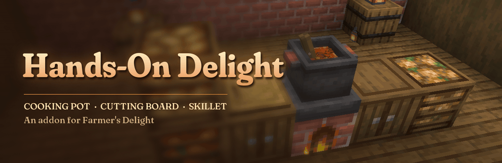
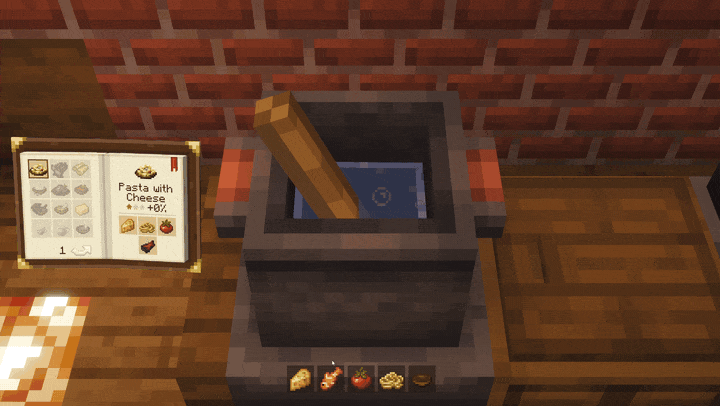
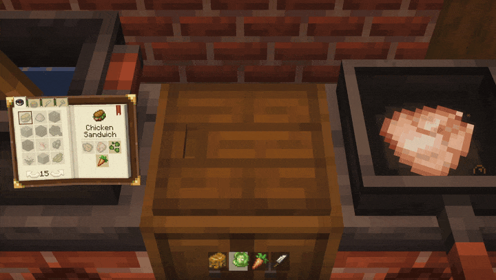
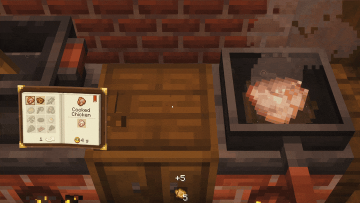
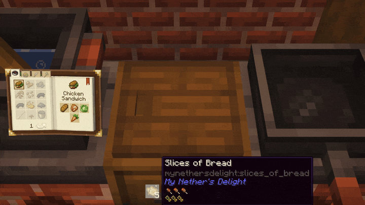
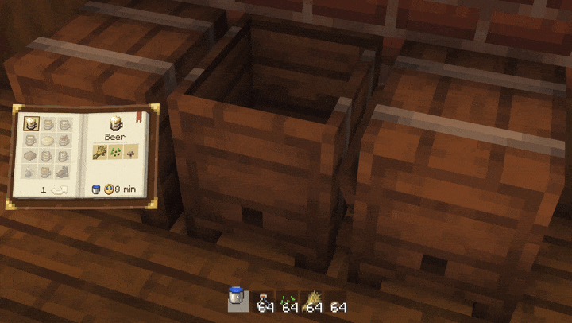
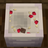

<p align="center">
  
</p>

<p align="center">
  <a href="https://www.curseforge.com/minecraft/mc-mods/hands-on-delight"></a>
  <a href="https://www.curseforge.com/minecraft/mc-mods/hands-on-delight/files"></a>
  <a href="https://files.minecraftforge.net"></a>
  <a href="https://www.curseforge.com/minecraft/mc-mods/farmers-delight"></a>
  <a href="https://discord.gg/mGkPKccJEf"></a>
  <a href="LICENSE"></a>
</p>

<p align="center"><i>Cook in <a href="https://www.curseforge.com/minecraft/mc-mods/farmers-delight">Farmer's Delight</a> with your own hands.</i></p>

<p align="center"><b>The cooking pot, the cutting board, the skillet, the stove and the stations of the addons open right where they stand, with no menu screen. You stir the soup with the spoon and chop with the knife yourself, and players nearby see what you cook.</b></p>

<p align="center"></p>

<p align="center"><b>No menus</b>, the blocks open in the world &middot; <b>Every recipe</b> of Farmer's Delight and its addons &middot; <b>No new blocks or items</b></p>

Built on [Diegesis](https://www.curseforge.com/minecraft/mc-mods/diegesis).

## Features

<h3 align="center">The cutting board</h3>
<p align="center"></p>
<p align="center"><i>Lay the food on the board and cut along the marks with the knife in hand.<br>One cut goes through sixteen at once, and the pieces fly into your inventory.</i></p>

<h3 align="center">The skillet</h3>
<p align="center"></p>
<p align="center"><i>Food fries on the side that lies in the pan. Toss the pan by its handle and it turns over in the air.</i></p>

<h3 align="center">Sandwiches on the board</h3>
<p align="center"></p>
<p align="center"><i>Bread first, then whatever goes on it: the last layer turns the stack into the dish.<br>Sandwiches no longer take the crafting table, and those of addons are built the same way.</i></p>

<h3 align="center">The keg</h3>
<p align="center"></p>
<p align="center"><i><a href="https://modrinth.com/mod/brewin-and-chewin">Brewin' and Chewin'</a>'s keg opens under its lid. Pour the water in and drop in what ferments.<br>When the drink is ready, the tap fills one mug at a time.</i></p>

<h3 align="center">The kettle</h3>
<p align="center"></p>
<p align="center"><i>Lift the lid of a kettle from <a href="https://modrinth.com/mod/gensokyo-delight-youkais-feasts">Gensokyo Delight: Youkai's Feasts</a> or <a href="https://modrinth.com/mod/farmers-respite">Farmer's Respite</a>, pour the water and drop the leaves in.<br>When the tea is brewed, tip the kettle by its handle and fill the cups.</i></p>

<h3 align="center">Sushi on the cuisine board</h3>
<p align="center"></p>
<p align="center"><i><a href="https://modrinth.com/mod/gensokyo-delight-youkais-feasts">Youkai's Feasts</a>' cuisine board builds rolls step by step, and the book beside it shows each step.<br>Roll the sheet up from your side and cut the roll with the knife.</i></p>

### In detail

- **Cooking pot.** Food floats in the water and colours it. Take the spoon by its handle and stir: the whole pot cooks
  as one batch, sixteen servings in about 27 seconds. Walk away and it cooks on as Farmer's Delight cooks, a serving at
  a time.
- **Stars.** Wide, steady rounds fill up to three stars over the dish. Two stars add a serving for every four, three
  stars one for every two. A dish opens its second star after 8 servings and its third after 32.
- **Recipe book.** It hangs beside the station and puts what you can make now first. Click a dish to read it, click it
  again and its ingredients go into the pot from your inventory; Shift + click puts in up to sixteen sets. Search it by
  name or mod, show only what you can make now, or open the dishes you made lately. Click an ingredient to see its own
  recipe. Pages turn with the wheel, Page Up and Page Down, or a click on the page's foot.
- **Cutting board.** Right-click it with food to lay the food down. The knife stays in your hand or inventory and shows
  over the food: chop on the dashed marks; each cut goes through sixteen items of the stack. Food is cut across its own length, a kelp roll in
  even slices and a pie in wedges, with one cut for each piece it gives, three at most. Everything else Farmer's Delight
  cuts on its board is worked there too, each with its own tool and stroke: an axe strips a log down its side and splits
  a door, a pickaxe cracks stone and bricks, a shovel digs into clay and gravel, a hoe pries the chest off a boat or a
  cart, shears snip leather armour and saddles.
- **Dishes on the board.** Farmer's Delight's food crafts move from the crafting table to the cutting board: lay what
  goes down first (bread, a bowl, a stick, kelp, wheat, a pie crust), put the rest on it, and the dish is made. Salads
  are tossed in their bowl and plated meals laid in it, sandwiches closed with their bread, skewers threaded from the
  tip, dough kneaded. Milk and honey are poured, eggs cracked. Machines such as Create's and
  AE2's autocrafters still craft them, and so do players without this mod on a server that has it.
- **Board recipe book.** Tabs show everything, the dishes only or the cuts only. Click a dish and it is laid from your
  inventory; Shift + click lays sixteen.
- **Skillet.** Food fries on the side that lies on the pan, then smokes and waits. Toss the pan by its handle to turn it.
  When both sides are done, click the food to take it. Up to sixteen fry together. Eggs go in cracked and fry
  sunny side up, with no toss.
- **Stove.** Up to six pieces grill on its top. Each one smokes when its lower side is done: click it to turn it over.
  Once both sides are done it waits on the grill until you take it. Eggs would run through the grill: fry them in a
  skillet.
- **Keg** of [Brewin' and Chewin'](https://modrinth.com/mod/brewin-and-chewin). Its lid opens on the
  liquid: pour a bucket or a bottle in at the opening, drop the ingredients in and they float while it ferments, the
  colour turning to the drink's. A thermometer on its badge shows how warm the keg is and how warm the recipe wants it.
  Click the tap with a tankard or a bottle to draw a drink and watch it run in and rise under its head of foam; with an
  empty hand one is offered from your inventory, and Shift draws as many as there are.
- **Kettle** of [Farmer's Respite](https://modrinth.com/mod/farmers-respite). Lift its lid off onto the stove, pour
  a bucket in at the opening and drop the leaves in: they float, soak and sink, giving the water their colour while it
  brews over the fire, with steam rising from the spout. Done, the kettle whistles. Click the spout with a bottle and
  the kettle is lifted by its handle and tipped to pour one; with an empty hand a bottle is offered from your
  inventory, and Shift pours every cup there is.
- **Kettle** of [Gensokyo Delight: Youkai's Feasts](https://modrinth.com/mod/gensokyo-delight-youkais-feasts). The same station: its water comes to the boil first, warming and
  steaming until the kettle whistles, then its four leaves steep into tea.
- **Cuisine board** of [Gensokyo Delight: Youkai's Feasts](https://modrinth.com/mod/gensokyo-delight-youkais-feasts). Sushi
  and rolls step by step, in the order its book shows: what you put on comes down onto the board, sauce is poured, an
  empty hand shapes the nigiri or rolls the sheet up, and a knife cuts the roll along dashed lines, as on the board.
- **Pots** of [Gensokyo Delight: Youkai's Feasts](https://modrinth.com/mod/gensokyo-delight-youkais-feasts): the small
  iron pot, the short iron pot and the stockpot. Food comes down into the soup, sauce and cream are poured, you stir
  the stockpot with its ladle, and the book has every dish of that pot with its time.
- **Steamer** of [Gensokyo Delight: Youkai's Feasts](https://modrinth.com/mod/gensokyo-delight-youkais-feasts), however
  tall. The lid comes off, food goes onto the place you let it go over, and a click on any rack opens it, with the racks
  over it lifted aside. The badge counts down what steams, and the book lays its recipes from your inventory.
- **Fermentation tank** of [Gensokyo Delight: Youkai's Feasts](https://modrinth.com/mod/gensokyo-delight-youkais-feasts).
  Its lid comes off with a click, liquids are poured in and things dropped in, and it ferments under the lid with the
  badge counting down. The drink is dipped out with a bottle, and the book puts its recipes in from your inventory.
- **The kitchen** of [Youkai's Homecoming](https://modrinth.com/mod/youkaishomecoming), which Youkai's Feasts is taken from:
  its kettle, cuisine board, pots, steamer and fermentation tank are the same stations, with its own teas, rolls and sakes.
- **Keg** of [Hearth and Harvest](https://modrinth.com/mod/hearth-and-harvest). Its lid comes off with a click: pour in a
  juice, water, milk or brine and drop in what ferments. Under the lid it ferments a portion at a time, the liquid turning
  to the drink's colour, and the wine is drawn into a bottle at its tap. An empty bucket or bottle at the opening takes back
  what has not fermented, a jar of pickles or a cheese wheel waits to be taken, and the book puts in as many of each as a
  recipe takes. Eight kegs built into a big keg open as one, from any of its blocks, with a lid in the middle of its top.
- **Cask** of [Hearth and Harvest](https://modrinth.com/mod/hearth-and-harvest). Lift its lid by the handle, lay in the
  bottles to age, salt and meat for jerky or a cheese, and put the lid back on to seal it. Sealed, a wine ages a bottle at
  a time into its next vintage, faster in a dark cellar; what is done waits before the cask and is taken without breaking
  the seal. The book shows each recipe's time where the cask stands.
- **Fermenting jar** of [Vintage Delight](https://modrinth.com/mod/vintage-delight). Lift its lid, drop the cucumbers and
  salt into the brine, and a bottle or bowl with them when the recipe takes one. Under the lid it ferments, bubbling, the
  brine taking the colour of what is in it and the badge counting down; the pickles wait before the jar and are taken
  with the lid on. The book puts a recipe in from your inventory.
- **Grill** of [Barbeque's Delight](https://modrinth.com/mod/barbeques-delight-forge). Two skewers lie over its fire.
  One smokes when its lower side is done: click it to turn it over, once. Click a skewer with a powder to shake it over
  or with a sauce to dab it on, and the seasoning stays on it. A skewer left on after it is done darkens, smokes and
  burns, as in Barbeque's Delight.
- **Ingredients basin** of [Barbeque's Delight](https://modrinth.com/mod/barbeques-delight-forge). Put the meat in one
  compartment and the side in the other. A stick from your inventory lies ready on its rim: click it and the pieces go
  onto it one after another, the side from the other compartment, nothing in your off hand. Shift makes as many as
  there is food for.
- **Alchemist pot** of [Farmer's Spell 'n Spell Book](https://modrinth.com/mod/farmers-spell). Stir it with its stick
  like the cooking pot. An [Iron's Spells 'n Spellbooks](https://modrinth.com/mod/irons-spells-n-spellbooks) scroll
  clicked on it hangs over its rim and its school shows on the pot: a fire scroll burns under it and heats it. Dishes
  that need a school wait for their scroll, which blinks on the badge and stands with them in the book.
- **Oven** of [Cooking for Blockheads](https://modrinth.com/mod/cooking-for-blockheads), in every colour. Its door
  drops open and the rack slides out over it: let raw food go over the rack and it fills the free places, or click one
  place with the right button. Coal or wood let go over the rack goes onto the fire, and an empty hand at its controls is
  offered fuel from your inventory. Each piece browns
  and rises as it bakes, and what is done waits on the open door with a puff of steam. The book lays its furnace food
  from your inventory. A skillet or a pot clicked on its top stands upright on the burner, and an empty hand takes it back.
  Sneak to open its own menu; hoppers and its heating unit work as before.
- **A kitchen.** Rest the cursor at the edge of the screen beside another station and the camera moves over to it. A, D
  and the arrow keys do the same.
- **For everyone.** Players nearby see the soup simmer, the spoon go round and the food land on the board.

## Controls

| Action | How |
|---|---|
| Open a station | Right-click the pot, board, skillet, stove, keg, kettle, grill or basin |
| Use the block as in Farmer's Delight | Sneak + right-click |
| Stir | Click the spoon's handle, move the mouse, click again to put it down |
| Serve | Click the soup with a bowl |
| Put a whole stack in | Shift + click it in the inventory |
| Cut | Left-click what lies on the board: the knife, or the tool the cut takes, comes from your inventory |
| Turn a piece on the stove | Click it |
| Take food back | Right-click it |
| Put the knife away | Right-click with it |
| Stick a tool into the board | Shift + click the bare board with it; click it to take it out |
| Go to the next station | Rest the cursor at the screen's edge on its side, or press A, D or an arrow key |

## Compatibility

[](https://www.curseforge.com/minecraft/mc-mods/jei) ✅ **[JEI](https://www.curseforge.com/minecraft/mc-mods/jei)** (optional) - shows the board's dishes

[](https://www.curseforge.com/minecraft/mc-mods/emi) ✅ **[EMI](https://www.curseforge.com/minecraft/mc-mods/emi)** (optional) - the same

[](https://www.curseforge.com/minecraft/mc-mods/roughly-enough-items) ✅ **[REI](https://www.curseforge.com/minecraft/mc-mods/roughly-enough-items)** (optional) - the same

[](https://modrinth.com/mod/culinary-compat) ✅ **[Culinary Compat](https://modrinth.com/mod/culinary-compat)** (optional, Forge 1.20.1) - its cuts of several things at once work on the board

[](https://www.curseforge.com/minecraft/mc-mods/embeddium) ✅ **[Embeddium](https://www.curseforge.com/minecraft/mc-mods/embeddium)** and [](https://www.curseforge.com/minecraft/mc-mods/oculus) **[Oculus](https://www.curseforge.com/minecraft/mc-mods/oculus)** (optional) - the stations draw as usual

<!-- stations:start -->
### Station compatibility

How much of each mod's kitchen opens as stations right in the world. A dash means the mod has no build for that version.

<details><summary><b>Every mod with stations and the planned ones</b></summary>

| Mod | Stations | 1.20.1 | 1.21.1 |
|---|---|:---:|:---:|
|  [Farmer's Delight](https://www.curseforge.com/minecraft/mc-mods/farmers-delight) |  100% | ✅ | ✅ |
|  [Barbeque's Delight](https://modrinth.com/mod/barbeques-delight-forge) |  100% | ✅ | ✅ |
|  [Brewin' and Chewin'](https://modrinth.com/mod/brewin-and-chewin) |  100% | ✅ | ✅ |
|  [Chopper's Delight](https://modrinth.com/mod/choppers-delight) |  100% | ✅ | ✅ |
|  [Cooking for Blockheads](https://modrinth.com/mod/cooking-for-blockheads) |  100% | ✅ | ✅ |
|  [Cultural Delights](https://modrinth.com/mod/cultural-delights) |  100% | - | ✅ |
|  [Dungeons Delight](https://modrinth.com/mod/dungeons_delight) |  100% | ✅ | ✅ |
|  [End's Delight](https://www.curseforge.com/minecraft/mc-mods/ends-delight) |  100% | ✅ | ✅ |
|  [Extra Delight](https://modrinth.com/mod/extradelight) |  83% | - | ✅ |
|  [Farmer's Respite](https://modrinth.com/mod/farmers-respite) |  100% | ✅ | ✅ |
|  [Farmer's Spell 'n Spell Book](https://modrinth.com/mod/farmers-spell) |  100% | ✅ | ✅ |
|  [Gensokyo Delight: Youkai's Feasts](https://modrinth.com/mod/gensokyo-delight-youkais-feasts) |  100% | ✅ | ✅ |
|  [Hearth and Harvest](https://modrinth.com/mod/hearth-and-harvest) |  100% | ✅ | ✅ |
|  [Miner's Delight](https://modrinth.com/mod/miners-delight) |  100% | ✅ | ✅ |
|  [My Nether's Delight](https://www.curseforge.com/minecraft/mc-mods/my-nethers-delight) |  100% | ✅ | ✅ |
|  [Nether's Delight](https://modrinth.com/mod/nethers-delight) |  100% | ✅ | - |
|  [Sable Trees](https://www.curseforge.com/minecraft/mc-mods/sable-trees) |  100% | - | ✅ |
|  [Trail&Tales Delight](https://modrinth.com/mod/trailtales-delight) |  50% | ✅ | ✅ |
|  [Twilight's Flavor & Delight](https://modrinth.com/mod/twilight-delight) |  100% | ✅ | ✅ |
|  [Vintage Delight](https://modrinth.com/mod/vintage-delight) |  100% | ✅ | - |
|  [Youkai's Homecoming](https://modrinth.com/mod/youkaishomecoming) |  83% | ✅ | - |
|  [Berries and Cherries Delight](https://modrinth.com/mod/berries-and-cherries) |  *planned* | | |
|  [Cuisine Delight](https://modrinth.com/mod/cuisine-delight) |  *planned* | | |
|  [Delightful](https://modrinth.com/mod/delightful) |  *planned* | | |
|  [Ender's Delight](https://modrinth.com/mod/enders-delight) |  *planned* | | |
|  [Farmer's Pizzeria](https://modrinth.com/mod/farmers-pizzeria) |  *planned* | | |
|  [Immortalers Delight](https://modrinth.com/mod/immortalers-delight) |  *planned* | | |
|  [Legendary Delicacies](https://www.curseforge.com/minecraft/mc-mods/legendary-delicacies) |  *planned* | | |
|  [Survivor's Delight](https://www.curseforge.com/minecraft/mc-mods/survivors-delight) |  *planned* | | |
|  [Ube's Delight](https://modrinth.com/mod/ubes-delight) |  *planned* | | |

</details>
<!-- stations:end -->

Addons of Farmer's Delight work too: their dishes are made on the board, their pies and cakes are cut in wedges, and
the stoves of [End's Delight](https://www.curseforge.com/minecraft/mc-mods/ends-delight) and
[My Nether's Delight](https://www.curseforge.com/minecraft/mc-mods/my-nethers-delight) open as stations. So do
[Miner's Delight](https://modrinth.com/mod/miners-delight)'s copper pot,
[Dungeons Delight](https://modrinth.com/mod/dungeons_delight)'s monster pot and dungeon stove,
[Twilight's Flavor & Delight](https://modrinth.com/mod/twilight-delight)'s maze stove (Twilight food still grills twice
as fast on it) and fiery cooking pot (it still heats itself and hurries Twilight dishes),
[Nether's Delight](https://modrinth.com/mod/nethers-delight)'s blackstone stove,
[Trail&Tales Delight](https://modrinth.com/mod/trailtales-delight)'s mud stove (its pottery cooking pot keeps Farmer's
Delight's menu), and every cutting board of
[Chopper's Delight](https://modrinth.com/mod/choppers-delight), the decorated one too, each in its own look.
[Farmer's Respite](https://modrinth.com/mod/farmers-respite)'s kettle opens as a station too, its tray on a stove
drawn with Farmer's Delight's own, and so does [Gensokyo Delight: Youkai's Feasts](https://modrinth.com/mod/gensokyo-delight-youkais-feasts)'s kettle,
its cuisine board, its three pots, its steamer and its fermentation tank, and those of
[Youkai's Homecoming](https://modrinth.com/mod/youkaishomecoming), which has the same kitchen.
[Farmer's Spell 'n Spell Book](https://modrinth.com/mod/farmers-spell)'s alchemist pot opens as a pot station with
its [Iron's Spells 'n Spellbooks](https://modrinth.com/mod/irons-spells-n-spellbooks) scroll.
[Barbeque's Delight](https://modrinth.com/mod/barbeques-delight-forge)'s kebabs and bibimbap are put together on the
board and keep the seasoning of their skewers.
[Cooking for Blockheads](https://modrinth.com/mod/cooking-for-blockheads)'s oven opens as a station in each of its
colours, its tools still standing on top, and so do [Hearth and Harvest](https://modrinth.com/mod/hearth-and-harvest)'s keg and cask
and [Vintage Delight](https://modrinth.com/mod/vintage-delight)'s fermenting jar.

Hoppers, pipes and drops use the blocks' own inventories. A pot fed by automation cooks by itself, as in Farmer's Delight.

## Configuration

`config/handson_delight.properties`, read at startup. On a server it decides for every player, except `recipe_book`,
which each player sets in their own file.

| Key | Default | What it does |
|---|---|---|
| `cooking_pot`, `cutting_board`, `skillet`, `stove` | `true` | The station of that block. Off, the block works as in Farmer's Delight. `cooking_pot` covers the addons' pots too (copper, monster, alchemist, fiery) |
| `keg` | `true` | The kegs of Brewin' and Chewin' and Hearth and Harvest as stations. Off, each keg keeps its own menu. Hearth and Harvest's keeps its own fermenting times |
| `kettle` | `true` | The kettles of Farmer's Respite and Youkai's Feasts as stations. Off, each is used as before |
| `grill`, `basin` | `true` | Barbeque's Delight's grill and ingredients basin as stations. Off, they are used as before |
| `cuisine_board` | `true` | Youkai's Feasts' cuisine board as a station. Off, it is used as before |
| `youkai_pots` | `true` | Youkai's Feasts' small iron pot, short iron pot and stockpot as stations. Off, they are used as before. They keep their own cooking times |
| `youkai_steamer` | `true` | Youkai's Feasts' steamer as a station. Off, it is used as before. It keeps its own steaming times |
| `youkai_tank` | `true` | Youkai's Feasts' fermentation tank as a station. Off, it is used as before. It keeps its own fermenting times |
| `cask` | `true` | Hearth and Harvest's cask as a station. Off, it keeps its own menu. It keeps its own aging times, faster in the dark |
| `fermenting_jar` | `true` | Vintage Delight's fermenting jar as a station. Off, it keeps its own menu. It keeps its own fermenting times |
| `oven` | `true` | Cooking for Blockheads' oven as a station. Off, it keeps its own menu. It keeps its own baking time |
| `youkai_hints` | `false` | Youkai's Feasts' squares on the right of the screen while one of its blocks is looked at (what it takes next, what lies in it). Hidden unless on |
| `remove_crafting_recipes` | `true` | Farmer's Delight's food crafts are made on the board only |
| `stirring_required` | `true` | Food you put into the pot waits for the spoon while you are at it |
| `recipe_book` | `true` | The recipe book beside the stations |
| `cooking_pot_time`, `skillet_time`, `stove_time` | `1.0` | How long food takes at that station: `2.0` twice as long, `0.5` half, from `0.1` to `10`. The pot's covers food left alone and fed by hoppers too, and the addons' pots |
| `kettle_time` | `1.0` | The same for drinks brewed in Farmer's Respite's kettle, at the station, in its menu or fed by a hopper. Youkai's Feasts' kettle keeps its own times |

## Modpacks

Recipes from datapacks and [KubeJS](https://www.curseforge.com/minecraft/mc-mods/kubejs) scripts work at every
station, whatever mod or datapack adds them: the pot cooks every `farmersdelight:cooking` recipe, the board cuts every
`farmersdelight:cutting` recipe, the skillet and the stove cook every campfire recipe. A soup, in
`data/mypack/recipes/carrot_soup.json`:

```json
{
  "type": "farmersdelight:cooking",
  "ingredients": [
    { "tag": "forge:crops/carrot" },
    { "item": "minecraft:brown_mushroom" }
  ],
  "result": { "item": "mypack:carrot_soup" },
  "container": { "item": "minecraft:bowl" },
  "cookingtime": 200,
  "experience": 1.0,
  "recipe_book_tab": "meals"
}
```

Dishes put together on the board are crafting recipes. The board takes those of Farmer's Delight and its addons by
itself; for any other shaped or shapeless craft, add its result to the item tag `handson_delight:assembled`. A sandwich,
in `data/mypack/recipes/club_sandwich.json`:

```json
{
  "type": "minecraft:crafting_shapeless",
  "ingredients": [
    { "item": "minecraft:bread" },
    { "item": "farmersdelight:cooked_bacon" },
    { "item": "farmersdelight:tomato" }
  ],
  "result": { "item": "mypack:club_sandwich" }
}
```

and in `data/handson_delight/tags/items/assembled.json`:

```json
{ "replace": false, "values": ["mypack:club_sandwich"] }
```

The same with KubeJS:

```js
ServerEvents.recipes(event => {
  event.shapeless('mypack:club_sandwich', ['minecraft:bread', 'farmersdelight:cooked_bacon', 'farmersdelight:tomato'])
})
ServerEvents.tags('item', event => event.add('handson_delight:assembled', 'mypack:club_sandwich'))
```

A dish takes two to nine ingredients, of more than one kind. The board chooses what goes down first and how the dish is
finished from its ingredients; to choose it yourself, tag the result `handson_delight:tossed` (a salad),
`handson_delight:arranged` (a plated meal), `handson_delight:wrapped` (rolled in bread) or `handson_delight:frozen` (a
popsicle). `handson_delight:not_assembled` keeps a dish in the crafting table, or off the board when another mod cuts it
together. Autocrafters still make the board's dishes.

## Installation

1. Minecraft 1.20.1 with [Forge](https://files.minecraftforge.net), 1.21.1 with [NeoForge](https://neoforged.net), or 1.20.1,
   1.21.1, 26.1.2 or 26.3 with [Fabric](https://fabricmc.net). On 26.1.2 and 26.3 the recipe viewers and the addon stations
   other than [Cultural Delights](https://modrinth.com/mod/cultural-delights)' are not supported yet.
2. [Farmer's Delight](https://www.curseforge.com/minecraft/mc-mods/farmers-delight), on Fabric
   [Farmer's Delight Refabricated](https://www.curseforge.com/minecraft/mc-mods/farmers-delight-refabricated) and
   [Fabric API](https://www.curseforge.com/minecraft/mc-mods/fabric-api).
3. [Diegesis](https://www.curseforge.com/minecraft/mc-mods/diegesis) and this mod in the `mods` folder, on the client and
   the server. A client without it keeps Farmer's Delight's own menus.

Bug reports, questions and ideas for new stations are welcome in [Pocky's Kitchen](https://discord.gg/mGkPKccJEf), our
Discord server.

## Building

```sh
./gradlew build
```

The jars are written to `forge/build/libs/` and `fabric/build/libs/`.

## Credits

- Author: **Pocky**.
- The recipe book's textures are by Catalyst.
- The broth sound is a recording by Joseph Sardin, released as CC0 on [BigSoundBank](https://bigsoundbank.com).
  Farmer's Delight's own sounds and models are used from the installed mod, never copied.

<!-- more-mods:start -->
## More mods by Pocky

**🌦️ Weather & nature**

<table>
  <tr>
    <td width="56"><a href="https://www.curseforge.com/minecraft/mc-mods/hoarfrost-snow-blizzards"></a></td>
    <td><a href="https://www.curseforge.com/minecraft/mc-mods/hoarfrost-snow-blizzards"><b>Hoarfrost: Snow & Blizzards</b></a> - seven kinds of snowfall, a living wind and soft snow on the land (<a href="https://github.com/Pocky-l/hoarfrost">source</a>)</td>
  </tr>
  <tr>
    <td width="56"><a href="https://www.curseforge.com/minecraft/mc-mods/petrichor-rain-storms"></a></td>
    <td><a href="https://www.curseforge.com/minecraft/mc-mods/petrichor-rain-storms"><b>Petrichor: Rain & Storms</b></a> - realistic rain, puddles, drips and branching lightning (<a href="https://github.com/Pocky-l/petrichor">source</a>)</td>
  </tr>
  <tr>
    <td width="56"><a href="https://www.curseforge.com/minecraft/mc-mods/rustling-leaves"></a></td>
    <td><a href="https://www.curseforge.com/minecraft/mc-mods/rustling-leaves"><b>Rustling Leaves</b></a> - falling leaves and leaf piles you can wade through and rake, client-side (<a href="https://github.com/Pocky-l/rustling-leaves">source</a>)</td>
  </tr>
</table>

**🎨 Graphics & performance**

<table>
  <tr>
    <td width="56"><a href="https://www.curseforge.com/minecraft/mc-mods/turbo-for-distant-horizons"></a></td>
    <td><a href="https://www.curseforge.com/minecraft/mc-mods/turbo-for-distant-horizons"><b>Turbo for Distant Horizons</b></a> - Distant Horizons terrain generated several times faster (<a href="https://github.com/Pocky-l/dhturbo">source</a>)</td>
  </tr>
  <tr>
    <td width="56"><a href="https://www.curseforge.com/minecraft/shaders/pocky-shaders"></a></td>
    <td><a href="https://www.curseforge.com/minecraft/shaders/pocky-shaders"><b>Pocky Shaders</b></a> - a cosy, natural shader pack that shows the weather of these mods (<a href="https://github.com/Pocky-l/pocky-shaders">source</a>)</td>
  </tr>
</table>

**🔮 Magic**

<table>
  <tr>
    <td width="56"><a href="https://www.curseforge.com/minecraft/mc-mods/hextale"></a></td>
    <td><a href="https://www.curseforge.com/minecraft/mc-mods/hextale"><b>HexTale</b></a> - hextech magic to research, distil and bind with runes, inspired by Arcane and Thaumcraft (<a href="https://github.com/Pocky-l/HexTale">source</a>)</td>
  </tr>
</table>

**⚡ Tech & energy**

<table>
  <tr>
    <td width="56"><a href="https://www.curseforge.com/minecraft/mc-mods/mekanism-advancedgenerators"></a></td>
    <td><a href="https://www.curseforge.com/minecraft/mc-mods/mekanism-advancedgenerators"><b>Mekanism Advanced Generators</b></a> - nine tiers of solar panels, big solar generators, cubes and cables for Mekanism (<a href="https://github.com/Pocky-l/Mekanism-MoreSolarPanels">source</a>)</td>
  </tr>
</table>

**🛠️ Server tools**

<table>
  <tr>
    <td width="56"><a href="https://www.curseforge.com/minecraft/mc-mods/inventory-backups"></a></td>
    <td><a href="https://www.curseforge.com/minecraft/mc-mods/inventory-backups"><b>Inventory Backups</b></a> - inventory and ender chest backups with one-click restore for admins (<a href="https://github.com/Pocky-l/inventory-backups">source</a>)</td>
  </tr>
</table>

**🧩 Libraries & addons**

<table>
  <tr>
    <td width="56"><a href="https://www.curseforge.com/minecraft/mc-mods/diegesis"></a></td>
    <td><a href="https://www.curseforge.com/minecraft/mc-mods/diegesis"><b>Diegesis</b></a> - a library for interfaces you work with right on the block, with no menu screen (<a href="https://github.com/Pocky-l/diegesis">source</a>)</td>
  </tr>
  <tr>
    <td width="56"><a href="https://www.curseforge.com/minecraft/mc-mods/hands-on-furniture"></a></td>
    <td><a href="https://www.curseforge.com/minecraft/mc-mods/hands-on-furniture"><b>Hands-On Furniture</b></a> - open MrCrayfish's fridges, cabinets and drawers by hand and put food anywhere on their shelves (<a href="https://github.com/Pocky-l/handson-furniture">source</a>)</td>
  </tr>
  <tr>
    <td width="56"><a href="https://www.curseforge.com/minecraft/mc-mods/hands-on-lets-do"></a></td>
    <td><a href="https://www.curseforge.com/minecraft/mc-mods/hands-on-lets-do"><b>Hands-On Let's Do</b></a> - work at the Let's Do stations with your own hands, right where they stand (<a href="https://github.com/Pocky-l/handson-letsdo">source</a>)</td>
  </tr>
  <tr>
    <td width="56"><a href="https://www.curseforge.com/minecraft/mc-mods/hands-on-vanilla"></a></td>
    <td><a href="https://www.curseforge.com/minecraft/mc-mods/hands-on-vanilla"><b>Hands-On Vanilla</b></a> - craft and smelt with your own hands, right on the crafting table and the furnace, client-side (<a href="https://github.com/Pocky-l/handson-vanilla">source</a>)</td>
  </tr>
</table>

<!-- more-mods:end -->

## License

[MIT](LICENSE)
